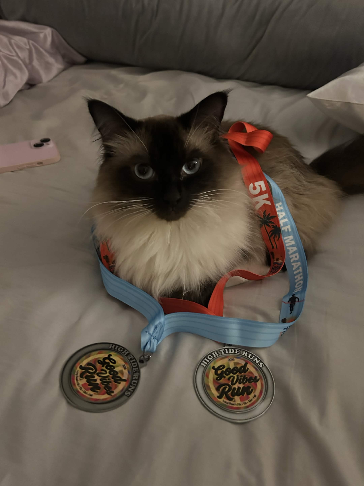
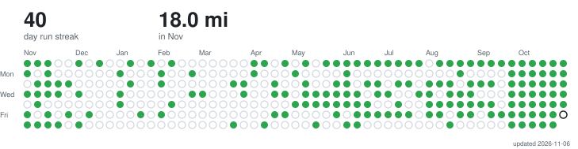

I really like running and cannoli

<table>
<tr>
<td valign="top">

**personal works**

**Plant Doctor - Multimodal Plant Health Agent** · [doi.org/10.1109/AMLDS69611.2026.11723615](https://doi.org/10.1109/AMLDS69611.2026.11723615)
A context-aware, multimodal diagnostic system for real-time plant health assessment. Co-authored research accepted to IEEE AMLDS 2026.
`Python` • `PyTorch` • `Computer Vision` • `Multimodal AI`

**Automated Patch Notes Pipeline**
An end-to-end pipeline that scrapes forum patch notes, classifies changes, regenerates the site, and broadcasts Discord alerts with zero manual intervention. Serving 20,000+ page views.
`Rust` • `Next.js` • `Tokio` • `Web Scraping`

**Cade - Personal Running Agent**
A fully local running coach that feeds Garmin data (via MCP) into a RAG pipeline to generate personalized training feedback.
`Python` • `ChromaDB` • `RAG` • `Semantic Search`

</td>
<td valign="top" align="center" width="220">

 
cannoli ^

</td>
</tr>
</table>

<picture>
  <source media="(prefers-color-scheme: dark)" srcset="https://raw.githubusercontent.com/Jovci/Jovci/strava/strava-graph-dark.svg">
  
</picture>
